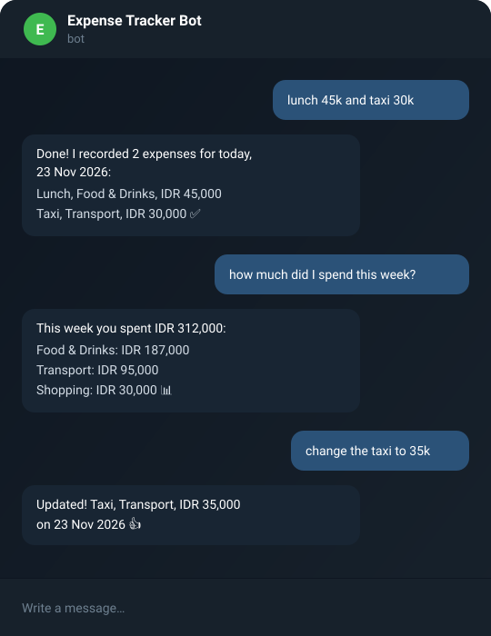
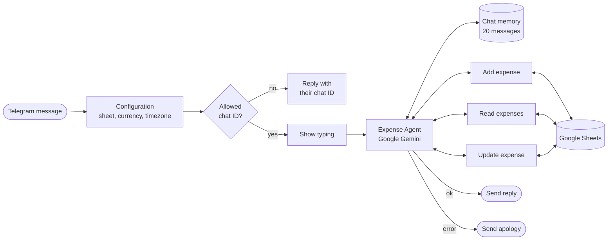

# AI Expense Tracker for Telegram (n8n)

A personal expense tracker you talk to in plain language. Send "coffee 25k" to a Telegram bot and it records the expense in Google Sheets, with the date and a category, in seconds. Ask how much you spent this week, or tell it to fix a wrong amount, and it reads or updates the sheet for you.

Built with n8n, a Google Gemini AI agent and Google Sheets. No app to install and no form to fill in: the chat is the interface.

    

---

## Preview

<p align="center">
  
</p>

<p align="center"><sub>Sample conversation. The bot replies in the language you write in.</sub></p>

---

## What it does

- Records expenses from natural messages: "lunch 45k and taxi 30k" becomes two rows
- Picks a category and fills in today's date when none is given
- Understands shorthand like `25k` or `25rb`
- Answers questions such as "how much did I spend this month on food?"
- Edits a record by description ("change the taxi to 35k"), asking which one if several match
- Remembers the last 20 messages per chat, so follow-up questions work
- Replies in the user's language
- Stays private: only chat IDs you allow can use it
- Never fails silently: if something breaks, the user gets a short apology

---

## How it works



Sticky notes inside the workflow explain each section and the setup steps.

---

## Engineering decisions

**Private by default.** The bot only works for chat IDs listed in `allowedChatIds`. Anyone else gets a reply with their own chat ID, which doubles as onboarding: the owner sends the first message, copies the ID from the reply, and pastes it into the configuration. A bot that writes to your spreadsheet should never be open to strangers.

**The agent does the parsing, the sheet stays clean.** Instead of regex rules for "25k", "Rp 25.000" or "two coffees at 18k", the agent turns free text into structured columns through tool calls. Amounts are written as plain numbers, so the sheet can be filtered, charted and summed directly.

**Honest tool use.** The system prompt makes the agent record expenses one at a time, retry a failed write once, and say plainly when something was not saved. It must ask about an unclear amount instead of guessing one.

**Edits by ID, not by row number.** Every record gets a unique ID like `EXP-20261123143000`. To change something, the agent reads the sheet, finds the ID, and updates that row with every column filled in, so a sorted or filtered sheet never causes the wrong row to change.

**One place for settings.** Spreadsheet ID, sheet name, currency, timezone and allowed users live in one Edit Fields node. The tools and the prompt read from it, so moving to another sheet or currency is a one-node change.

**Small, fast and consistent.** Gemini Flash-Lite at temperature 0.3 keeps replies quick and predictable, which matters more than creativity when the job is writing numbers into a sheet.

---

## Tech stack

| Part | Tool |
|---|---|
| Orchestration | n8n |
| AI agent | n8n AI Agent with Google Gemini (`gemini-3.5-flash-lite`) |
| Memory | n8n Simple Memory, 20 messages per chat |
| Storage | Google Sheets |
| Channel | Telegram Bot API |

---

## Repository structure

```
.
├── workflow/
│   └── ai-expense-tracker-telegram.json   # Import this into n8n
├── sheet-template/
│   └── expenses-template.csv              # Header row for your Google Sheet
├── docs/
│   └── setup-guide.md                     # Step-by-step setup and troubleshooting
├── assets/
│   └── chat-preview.svg
└── LICENSE
```

---

## Setup (about 15 minutes)

1. **Sheet:** create a Google Sheet with a tab named `Expenses` and the headers `ID`, `Date`, `Description`, `Category`, `Amount` (or import [`sheet-template/expenses-template.csv`](sheet-template/expenses-template.csv)).
2. **Import:** in n8n, import [`workflow/ai-expense-tracker-telegram.json`](workflow/ai-expense-tracker-telegram.json).
3. **Credentials:** Telegram (token from [@BotFather](https://t.me/BotFather)), Google Gemini (API key from [Google AI Studio](https://aistudio.google.com)) and Google Sheets (OAuth2).
4. **Configuration:** fill in the fields below.
5. **Activate**, send any message to the bot, and copy the chat ID from its reply into `allowedChatIds`.

| Field | Default | Description |
|---|---|---|
| `spreadsheetId` | `YOUR_SPREADSHEET_ID` | The long ID in the sheet's URL, between `/d/` and `/edit` |
| `sheetName` | `Expenses` | Tab that holds the records |
| `currency` | `IDR` | Currency shown in replies |
| `timezone` | `Asia/Jakarta` | Used for "today", "this week" and record IDs |
| `allowedChatIds` | `YOUR_TELEGRAM_CHAT_ID` | Comma-separated Telegram chat IDs that may use the bot |

Full instructions and fixes for common errors: [`docs/setup-guide.md`](docs/setup-guide.md).

---

## Known limitations

- **Text only.** Photos, receipts and voice notes are not read yet; the bot asks the user to type the expense.
- **No deleting.** The bot can add, view and update records. Rows are deleted by hand in the sheet.
- **Totals come from the model.** Summaries are calculated by the AI from the rows it reads. They are reliable for personal use, but double-check large or important totals in the sheet.
- **Memory resets on restart.** Simple Memory lives in n8n's process; the sheet itself is never lost.

---

## Customization

- **Categories, tone and rules:** edit the system message in *Expense Agent*
- **Another model:** swap *Google Gemini Chat Model* for OpenAI, OpenRouter, Groq or any chat model node
- **Shared budget:** add several chat IDs to `allowedChatIds` so a household or team logs into one sheet
- **Receipts:** add an image branch that sends photos to a vision model before the agent

---

## Author

Built by **Eko Sarwono** as part of an AI automation portfolio.

Licensed under the [MIT License](LICENSE).
